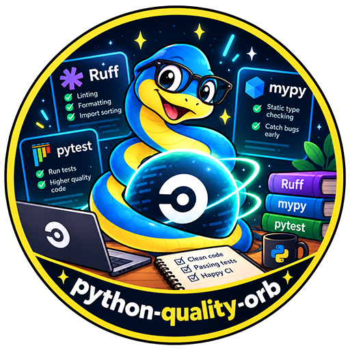
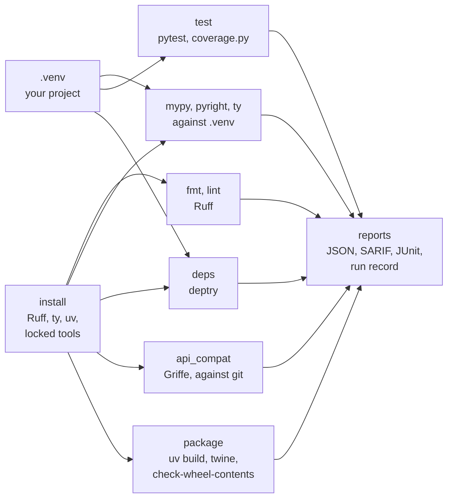

<div align="center">



# Python Quality for CircleCI and GitHub Actions

### Format, lint, type-check and test Python code, keep its dependencies honest, catch API changes that break callers, and check what you ship.

Install a checksum-verified [Ruff](https://docs.astral.sh/ruff/), [ty](https://docs.astral.sh/ty/), [mypy](https://mypy-lang.org), [Pyright](https://microsoft.github.io/pyright/), [deptry](https://deptry.com), [Griffe](https://mkdocstrings.github.io/griffe/), [twine](https://twine.readthedocs.io/) and [check-wheel-contents](https://github.com/jwodder/check-wheel-contents), and hold Python code to a standard on every commit, as orb commands or GitHub Actions.<br>
Your project's own environment for tests and imports · Your project's configuration, never the job's leftovers · Python 3.10 and newer<br>
Gates that tell findings from failures · SARIF, JUnit and run records · No `sudo`

[](https://circleci.com/gh/juburr/python-quality-orb)
[](https://github.com/juburr/python-quality-orb/actions/workflows/actions.yml)
[](https://circleci.com/developer/orbs/orb/juburr/python-quality-orb)
[](LICENSE)
[](https://discuss.circleci.com/c/ecosystem/orbs)


**[Quick Start](#-quick-start)** · **[Features](#-why-python-quality-orb)** · **[Recipes](#-recipes)** · **[Commands](#-commands)** · **[GitHub Actions](#-github-actions)** · **[Security](#-secure-by-design)** · **[Network Access](#-network-access)**

<sub>An unofficial, community-maintained CircleCI orb and set of GitHub Actions, not affiliated with the Python Software Foundation, Astral, Microsoft, or the projects whose tools it installs. [Contributions are welcome!](#-contributing)</sub>

</div>

<br>

## ✨ Why python-quality-orb?

<table>
<tr>
<td width="33%" valign="top">
📦 <b>Tools you can trust</b><br><br>
Ruff, ty and uv are release binaries checked against this orb's SHA-512 tables, anchored to their published checksums and GitHub build attestations. mypy, Pyright, deptry, Griffe, twine and check-wheel-contents install with that uv, each into an environment of its own, from a lock that pins every wheel by SHA-256.
</td>
<td width="33%" valign="top">
🧹 <b>Format and lint, read-only</b><br><br>
<code>fmt</code> and <code>lint</code> run Ruff with your project's configuration and never change a file: <code>fix = true</code> in it never applies. A file Ruff can't parse or read fails the step instead of quietly going unchecked.
</td>
<td width="33%" valign="top">
🔎 <b>Three type checkers, one way</b><br><br>
<code>mypy</code>, <code>pyright</code> and <code>ty</code> check against the packages installed in your project's environment, at its Python version unless your configuration names one. Plugins that need mypy in your environment get <code>runner: project</code>.
</td>
</tr>
<tr>
<td width="33%" valign="top">
🧪 <b>Tests where they belong</b><br><br>
<code>test</code> runs pytest, with coverage.py if you like, in your project's own environment, gates coverage in whole numbers, and on CircleCI splits the test files across parallel nodes by their timings.
</td>
<td width="33%" valign="top">
🧭 <b>Dependencies and API, checked</b><br><br>
<code>deps</code> finds imports nothing declares and dependencies nothing imports, with deptry on your environment's Python. <code>api_compat</code> compares your package's API with the base branch's, without importing anything, and names every change that breaks callers.
</td>
<td width="33%" valign="top">
🚦 <b>Gates you can trust</b><br><br>
Findings fail the step unless <code>report_only</code> is true. A tool that crashed, a file it couldn't parse, a run that checked nothing, or an exit code that disagrees with the report fails it either way.
</td>
</tr>
</table>

### 🧩 The Orb vs. a Hand-Rolled Script

| | Hand-rolled | python-quality-orb |
|---|---|---|
| Installing the tools | `pip install` of whatever is newest today, into the project's environment | checksum-verified binaries, and a hash-pinned lock per tool, in environments of their own |
| `fix = true` in Ruff's configuration | `ruff check` rewrites files in CI | `--no-fix`: nothing changes |
| A file Ruff can't read | a warning in the log, and a pass | fails the step |
| mypy in the orb's environment | checks against the wrong Python version and no installed packages | `--python-executable` and the environment's version, unless configured |
| deptry run from a tool environment | sees the tool's packages, not the project's | runs on the project's Python |
| A test module that doesn't import | pytest exits 2, which reads like a failure | no verdict, whatever else is set |
| 1999 of 2000 lines covered, with a minimum of 100% | rounds to 100.0%, and passes | fails |
| `twine check` output | colored by a forced terminal, hard to read | read through the escape codes, one finding per problem |

## 🔄 How It Works



1. **`install`** puts the tools named in `tools` on the `PATH`, each verified first.
2. Your job makes the project's environment, such as with `uv sync` or `pip install`, as it would to run the tests.
3. **Each check** runs its tool, writes the reports, and fails the step on findings.

## 🚀 Quick Start

### CircleCI

```yaml
version: 2.1

orbs:
  python-quality: juburr/python-quality-orb@0.1.0

jobs:
  quality:
    docker:
      - image: cimg/python:3.13
    steps:
      - checkout
      - run:
          name: Make the project's environment
          command: |
            python -m venv .venv
            .venv/bin/pip install -e . pytest coverage
      - python-quality/install:
          tools: ruff,mypy
      - python-quality/fmt
      - python-quality/lint
      - python-quality/mypy
      - python-quality/test:
          coverage: true
          coverage_min: "90"

workflows:
  quality:
    jobs:
      - quality
```

The type checkers and `test` use the environment in `.venv`; name another in `environment`. The reports are in the job's artifacts under `python-quality-reports/`, and the findings and test results in its Tests tab.

### GitHub Actions

```yaml
jobs:
  quality:
    runs-on: ubuntu-24.04
    permissions:
      contents: read
      security-events: write
    steps:
      - uses: actions/checkout@v7
      - uses: juburr/python-quality-orb/actions/install@v0.1.0
        with:
          tools: ruff,ty,uv
      - run: uv sync
      - uses: juburr/python-quality-orb/actions/fmt@v0.1.0
      - uses: juburr/python-quality-orb/actions/lint@v0.1.0
      - uses: juburr/python-quality-orb/actions/ty@v0.1.0
      - uses: juburr/python-quality-orb/actions/test@v0.1.0
      - uses: github/codeql-action/upload-sarif@v4
        if: always()
        with:
          sarif_file: /tmp/python-quality-reports
```

## 🍳 Recipes

### Adopt the Checks Gradually

```yaml
- python-quality/lint:
    report_only: true
- python-quality/pyright:
    fail_on: error # warnings and informations are reported, not findings
```

`report_only` writes every report and passes; a check that couldn't run still fails.

### mypy With Plugins

```yaml
- python-quality/mypy:
    runner: project # mypy and pydantic.mypy are installed in .venv
```

mypy imports plugins into its own process, so a configuration that loads them (`plugins = ["pydantic.mypy"]`) needs the mypy in your environment. With the default `runner: orb`, the step fails before mypy runs, naming the plugins it can't load.

### Split Tests Across Parallel Nodes

```yaml
jobs:
  test:
    parallelism: 4
    docker:
      - image: cimg/python:3.13
    steps:
      - checkout
      - run: python -m venv .venv && .venv/bin/pip install -e . pytest
      - python-quality/test:
          split_tests: true
```

Each node runs its share of the test files, split by the timings in the JUnit reports CircleCI stored from earlier runs.

### Find Breaking API Changes

```yaml
- python-quality/install:
    tools: griffe
- python-quality/api_compat:
    package: mypackage
    ignore: mypackage._internal.*
```

On a pull request on GitHub Actions, the base is the pull request's base branch; elsewhere the remote's default branch, at the merge base. Compare a release with the last tag instead with `base_ref: v1.4.0` and `merge_base: false`. On GitHub Actions, check out with `fetch-depth: 0`.

### Check What You Ship

```yaml
- python-quality/install:
    tools: uv,twine,check-wheel-contents
- python-quality/package:
    out_dir: dist # keep the checked distributions for the publish step
```

`uv build` makes the sdist, then the wheel from it, without `[tool.uv.sources]`, as anyone who installs the sdist builds it.

### Upload SARIF to GitHub Code Scanning

Every check but `test` and `package` writes `<report_name>.sarif` in `output_dir`, with paths relative to the top of the checkout. On GitHub Actions, upload them with `github/codeql-action/upload-sarif`.

### Keep a Run Record

`run_record: true` writes `<report_name>.run-record.json`: the tool and how it was installed, its arguments, the environment it checked against, the configuration with its SHA-256, what it found, and the CI job. [`schemas/run-record.v1.json`](schemas/run-record.v1.json) describes it.

## 🧰 Commands

| Command | What it does |
|---|---|
| [`install`](#python-qualityinstall) | Installs the tools named in `tools` |
| [`install_ruff`](#python-qualityinstall_ruff) | Installs Ruff, verified against this orb's checksum table |
| [`install_ty`](#python-qualityinstall_ty) | Installs ty, verified against this orb's checksum table |
| [`install_uv`](#python-qualityinstall_uv) | Installs uv, verified against this orb's checksum table |
| [`install_python`](#python-qualityinstall_python) | Installs the Python the tools run on, alone |
| [`install_mypy`](#python-qualityinstall_mypy) | Installs mypy from this orb's lock |
| [`install_pyright`](#python-qualityinstall_pyright) | Installs Pyright, with Node.js, from this orb's lock |
| [`install_deptry`](#python-qualityinstall_deptry) | Installs deptry from this orb's lock |
| [`install_griffe`](#python-qualityinstall_griffe) | Installs Griffe from this orb's lock |
| [`install_twine`](#python-qualityinstall_twine) | Installs twine from this orb's lock |
| [`install_check_wheel_contents`](#python-qualityinstall_check_wheel_contents) | Installs check-wheel-contents from this orb's lock |
| [`fmt`](#python-qualityfmt) | Checks the formatting with Ruff |
| [`lint`](#python-qualitylint) | Lints with Ruff |
| [`mypy`](#python-qualitymypy) | Type-checks with mypy |
| [`pyright`](#python-qualitypyright) | Type-checks with Pyright |
| [`ty`](#python-qualityty) | Type-checks with ty |
| [`test`](#python-qualitytest) | Runs the tests with pytest, and coverage.py |
| [`deps`](#python-qualitydeps) | Checks the declared dependencies against the imports, with deptry |
| [`api_compat`](#python-qualityapi_compat) | Finds API changes that break callers, with Griffe |
| [`package`](#python-qualitypackage) | Builds and checks the distributions |

Every parameter that names a value expands environment variables, except `output_dir`, which `store_artifacts` reads too. The checks share these parameters:

| Parameter | Default | Description |
|---|---|---|
| `working_dir` | `.` | The directory to run in; paths are relative to it |
| `environment` | `.venv` | The project's environment: a directory such as `.venv`, or an interpreter (`mypy`, `pyright`, `ty`, `test`, `deps`) |
| `output_dir` | `/tmp/python-quality-reports` | Absolute path of the directory for the reports |
| `report_name` | the command's | The reports' file name without its extension |
| `junit` | `true` | Write JUnit to `output_dir/junit/<report_name>.xml` and store it |
| `run_record` | `false` | Also write `<report_name>.run-record.json` |
| `report_only` | `false` | Report findings without failing the step (all but `test`) |
| `extra_args` | | Further options for the tool, split like shell words, nothing expanded or run; options the command sets, and words it would read as a path, are refused |
| `store_artifacts` | `true` | Store `output_dir` under `python-quality-reports/`, also when the step fails |

### `python-quality/install`

| Parameter | Default | Description |
|---|---|---|
| `tools` | `ruff,mypy` | Any of `ruff`, `ty`, `mypy`, `pyright`, `deptry`, `griffe`, `twine`, `check-wheel-contents`, `uv` and `python`, separated by commas or spaces |
| `ruff_version` | `0.17.2` | The Ruff release |
| `ty_version` | `0.0.91` | The ty release |
| `mypy_version` | `2.4.0` | The mypy release |
| `pyright_version` | `1.1.414` | The Pyright release |
| `deptry_version` | `0.25.1` | The deptry release |
| `griffe_version` | `2.4.1` | The Griffe release |
| `twine_version` | `7.0.0` | The twine release |
| `check_wheel_contents_version` | `0.6.3` | The check-wheel-contents release |
| `uv_version` | `0.13.6` | The uv release, installed whenever a tool needs it |
| `python` | `3.14` | The Python the locked tools run on: `3.11` to `3.14` for a CPython uv downloads, `system`, or an interpreter's absolute path. It isn't your project's Python |
| `index_url` | `https://pypi.org/simple` | The package index to install the locked tools from |
| `python_install_mirror` | | A mirror of uv's Python downloads, `https://` or `file://` |
| `download_base_url` | | A mirror of GitHub Releases, in place of `https://github.com` |
| `caching` | `true` | Cache the verified releases and the Python archive between jobs |
| `install_path` | `~/.python-quality-orb/bin` | Where the tools go, added to the `PATH` ahead of any an image or `.venv` ships |
| `verify_checksums` | `strict` | `strict`, `known_versions` or `false` (see [Checksum Verification](#-checksum-verification)) |

### `python-quality/install_ruff`

| Parameter | Default | Description |
|---|---|---|
| `version` | `0.17.2` | The Ruff release, from 0.16.0 |
| `verify_checksums` | `strict` | `strict`, `known_versions` or `false` |
| `install_path` | `~/.python-quality-orb/bin` | Directory for `ruff`, added to the `PATH` |
| `download_base_url` | | An https mirror of GitHub Releases |
| `caching` | `true` | Cache the verified release between jobs |

### `python-quality/install_ty`

As `install_ruff`, with `version` defaulting to `0.0.91`, from 0.0.84.

### `python-quality/install_uv`

As `install_ruff`, with `version` defaulting to `0.13.6`, from 0.13.0. The install commands of the locked tools run it first unless `install_uv` is false, and `package` builds with it.

### `python-quality/install_python`

`python`, `python_install_mirror`, `caching`, `install_path`, `verify_checksums`, `download_base_url`, `uv_version` and `install_uv`, as for `install_mypy`. Installs the Python the tools and the orb's helper run on, and exports it as `PYTHON_QUALITY_ORB_PYTHON`. `mypy`, `test` and `api_compat` read their tools' reports with it, or with the `python3` on the `PATH` (3.11 or newer).

### `python-quality/install_mypy`

`version` (default `2.4.0`), `python`, `index_url`, `python_install_mirror`, `caching`, `install_path`, `verify_checksums`, `download_base_url` and `uv_version`, as for `install`, and `install_uv` (default `true`): install uv first, or use the one an earlier `install_uv` put in `install_path`. mypy runs from its own environment with `python -I`, through a script named `mypy` in `install_path`.

### `python-quality/install_pyright`

As `install_mypy`, with `version` defaulting to `1.1.414`. The lock holds Node.js as a wheel (Pyright's `nodejs` extra), so Pyright never downloads Node.js or npm packages.

### `python-quality/install_deptry`

As `install_mypy`, with `version` defaulting to `0.25.1`.

### `python-quality/install_griffe`

As `install_mypy`, with `version` defaulting to `2.4.1`. Griffe reads code without importing it, so the Python it runs on must be at least as new as your code's syntax.

### `python-quality/install_twine`

As `install_mypy`, with `version` defaulting to `7.0.0`.

### `python-quality/install_check_wheel_contents`

As `install_mypy`, with `version` defaulting to `0.6.3`.

### `python-quality/fmt`

| Parameter | Default | Description |
|---|---|---|
| `paths` | | Files and directories to check; empty for Ruff's default, as its `include` and `exclude` select |
| `config` | | A Ruff configuration file to use instead of the one Ruff finds |
| `allow_empty` | `false` | Pass when Ruff finds no Python file |
| `report_name` | `fmt` | |

`ruff format --check --output-format json --no-cache`. A file the formatter would change is a finding. Reports: `<report_name>.json`, `<report_name>.sarif`, `<report_name>.diff` (the changes `ruff format` would make) and JUnit. A file Ruff can't parse or read fails the step either way, with a hint to leave it out with `extend-exclude`.

### `python-quality/lint`

| Parameter | Default | Description |
|---|---|---|
| `paths` | | Files and directories to lint; empty for Ruff's default |
| `config` | | A Ruff configuration file to use instead of the one Ruff finds |
| `allow_empty` | `false` | Pass when Ruff finds no Python file |
| `report_name` | `lint` | |

`ruff check --no-fix --no-fix-only --output-format json --no-cache`, with the rules your configuration selects. Every diagnostic is a finding, with its rule and documentation link in the reports. A file Ruff can't parse (`invalid-syntax`), or can't read, which Ruff only warns about unless `E902` is selected, fails the step either way. The job's `RUFF_*` variables never reach Ruff.

### `python-quality/mypy`

| Parameter | Default | Description |
|---|---|---|
| `paths` | | Files and directories; empty for `files`, `packages` or `modules` in mypy's configuration, or else the working directory |
| `config` | | A mypy configuration file to use instead of the one mypy finds |
| `runner` | `orb` | `orb`: this orb's mypy, told where the environment is. `project`: the mypy in the environment, for plugins |
| `report_name` | `mypy` | |

mypy runs with `-O json --no-error-summary`, `--python-executable` the environment's interpreter, and `--python-version` its version unless the configuration sets `python_version`. With `environment: ""`, it runs with `--no-site-packages`. Errors are findings; notes are reported. A run mypy stopped (exit 2: a syntax error, a configuration or plugin it can't use, no files) fails the step either way. mypy finds its configuration as mypy does: `mypy.ini`, `.mypy.ini`, `[tool.mypy]` in `pyproject.toml`, or `[mypy]` in `setup.cfg`, upward to the top of the repository, then the user's.

### `python-quality/pyright`

| Parameter | Default | Description |
|---|---|---|
| `paths` | | Files and directories; empty for `include` in Pyright's configuration, or else the working directory |
| `project` | | A Pyright configuration file, or its directory, instead of the one Pyright finds |
| `fail_on` | `error` | The lowest severity that is a finding: `error`, `warning` or `information` |
| `allow_empty` | `false` | Pass when Pyright analyzes no file |
| `report_name` | `pyright` | |

`pyright --outputjson --pythonpath <environment>`. Pyright takes the Python version from the environment unless its configuration sets `pythonVersion`. A run that couldn't complete (exit 2 to 4) fails the step either way. The job's `PYRIGHT_PYTHON_*` variables, which could make it download another Pyright or Node.js, are ignored.

### `python-quality/ty`

| Parameter | Default | Description |
|---|---|---|
| `paths` | | Files and directories; empty for ty's default, the project |
| `config` | | A `ty.toml` to use instead of the one ty finds |
| `fail_on` | `warning` | The lowest severity that is a finding: `error`, `warning` (ty's own `error-on-warning`) or `info` |
| `allow_empty` | `false` | Pass when ty finds no Python file |
| `report_name` | `ty` | |

`ty check --output-format gitlab --python <environment>`. ty is in beta: its diagnostics change between releases, so pin `ty_version`. A file ty can't read, a configuration it can't use, or a crash fails the step either way. The job's `TY_*` variables and a user-level ty configuration are ignored.

### `python-quality/test`

| Parameter | Default | Description |
|---|---|---|
| `paths` | | Test files and directories; empty for pytest's `testpaths`, or else the working directory |
| `coverage` | `false` | Measure coverage with coverage.py, installed in the environment |
| `coverage_source` | | Packages or directories to measure (`--source`); empty for the project's configuration |
| `coverage_min` | | The lowest coverage that passes, such as `80` or `92.5`; it replaces the project's `fail_under` |
| `coverage_config` | | A coverage.py configuration file to use instead of the one it finds |
| `split_tests` | `false` | With CircleCI's parallelism, run this node's share of the test files, split by timings |
| `allow_empty` | `false` | Pass when pytest collects no test |
| `report_name` | `test` | |

`python -m pytest --junitxml=output_dir/junit/<report_name>.xml -o junit_family=legacy`, in the environment, where pytest, the project and its dependencies are installed. With `coverage`, `python -m coverage run --parallel-mode -m pytest`, then `combine`, a JSON, a Cobertura XML and a text report. Failed and erroring tests, `--max-warnings` exceeded (exit 6), and coverage below `coverage_min`, compared in whole numbers, or below the project's `fail_under`, fail the step. A run pytest couldn't complete (exit 2 to 4, such as a test module that doesn't import) fails it as no result, and so does one that collected no test, unless `allow_empty`. There is no `report_only`: failing tests fail the step.

### `python-quality/deps`

| Parameter | Default | Description |
|---|---|---|
| `paths` | | Directories whose Python files deptry reads; empty for the working directory |
| `config` | | The `pyproject.toml` with the dependencies and `[tool.deptry]`; empty for `pyproject.toml` |
| `allow_empty` | `false` | Pass when deptry finds no Python file |
| `report_name` | `deps` | |

deptry runs on the environment's Python (3.10 or newer), with the packages of this orb's deptry environment in front of the project's, so the project's installed packages and Python version decide what each import resolves to. Each violation (`DEP001` to `DEP005`) is a finding. deptry exits 1 for violations and for a failure alike, so the JSON report decides. Give its options in their long form in `extra_args`, such as `--per-rule-ignores=DEP002=uvicorn`.

### `python-quality/api_compat`

| Parameter | Default | Description |
|---|---|---|
| `package` | | Import packages to compare; empty for the one named after `pyproject.toml`'s project, in `src/` or at the top |
| `search_paths` | | Directories the packages are in; empty for `src` (if it exists) and the working directory |
| `base_ref` | | The branch, tag or commit to compare with; empty for the pull request's base branch on GitHub Actions, or else `origin/HEAD`, `origin/main` or `origin/master` |
| `merge_base` | `true` | Compare with where this branch left `base_ref`, not `base_ref` itself |
| `ignore` | | Objects whose changes are expected, by path or glob, such as `mypackage._compat.*` |
| `report_name` | `api_compat` | |

Griffe reads both versions statically, so nothing is imported or run, and the project's dependencies needn't be installed. The base comes out of git with `git archive` into a temporary directory; the checkout and its git metadata are left alone. Each breaking change (a removed object, a removed, moved or newly required parameter, a changed default or kind, an incompatible return or attribute type, a removed base class) is a finding. A package the base doesn't have is new, and passes. Reports: `<report_name>.json` (with the old and new values and Griffe's explanation), `<report_name>.sarif` and JUnit.

### `python-quality/package`

| Parameter | Default | Description |
|---|---|---|
| `dists` | | Distributions built earlier to check, such as `dist/*`; empty to build with uv |
| `out_dir` | | Where to keep the distributions built; empty for `output_dir/<report_name>-dist` |
| `no_sources` | `true` | Build without `[tool.uv.sources]` (`uv build --no-sources`) |
| `twine` | `true` | Check every distribution with `twine check --strict` |
| `check_wheel_contents` | `true` | Check every wheel with check-wheel-contents |
| `check_wheel_contents_args` | | Its options, such as `--ignore=W002` |
| `report_name` | `package` | |

`uv build` makes the sdist, then the wheel from it. Each problem twine or check-wheel-contents reports is a finding, by distribution. A build that fails, an sdist or wheel missing, or a checker that couldn't read a distribution fails the step either way. `extra_args` go to `uv build`.

## ⚡ GitHub Actions

Every command has a composite action of the same name, with the same inputs and defaults, running the same scripts:

| Action | Command |
|---|---|
| `juburr/python-quality-orb/actions/install@v0.1.0` | `install` |
| `juburr/python-quality-orb/actions/install_ruff@v0.1.0` | `install_ruff` |
| `juburr/python-quality-orb/actions/install_ty@v0.1.0` | `install_ty` |
| `juburr/python-quality-orb/actions/install_uv@v0.1.0` | `install_uv` |
| `juburr/python-quality-orb/actions/install_python@v0.1.0` | `install_python` |
| `juburr/python-quality-orb/actions/install_mypy@v0.1.0` | `install_mypy` |
| `juburr/python-quality-orb/actions/install_pyright@v0.1.0` | `install_pyright` |
| `juburr/python-quality-orb/actions/install_deptry@v0.1.0` | `install_deptry` |
| `juburr/python-quality-orb/actions/install_griffe@v0.1.0` | `install_griffe` |
| `juburr/python-quality-orb/actions/install_twine@v0.1.0` | `install_twine` |
| `juburr/python-quality-orb/actions/install_check_wheel_contents@v0.1.0` | `install_check_wheel_contents` |
| `juburr/python-quality-orb/actions/fmt@v0.1.0` | `fmt` |
| `juburr/python-quality-orb/actions/lint@v0.1.0` | `lint` |
| `juburr/python-quality-orb/actions/mypy@v0.1.0` | `mypy` |
| `juburr/python-quality-orb/actions/pyright@v0.1.0` | `pyright` |
| `juburr/python-quality-orb/actions/ty@v0.1.0` | `ty` |
| `juburr/python-quality-orb/actions/test@v0.1.0` | `test` |
| `juburr/python-quality-orb/actions/deps@v0.1.0` | `deps` |
| `juburr/python-quality-orb/actions/api_compat@v0.1.0` | `api_compat` |
| `juburr/python-quality-orb/actions/package@v0.1.0` | `package` |

What one action exports, later steps see, as with CircleCI's `BASH_ENV`. A few differences:

- **Check out with history** for `api_compat` (`fetch-depth: 0`), since `actions/checkout` fetches one commit by default.
- **Quote booleans and numbers** in `with:` (`report_only: "true"`, `coverage_min: "90"`), since every input is a string.
- **Environment variables aren't expanded in inputs.** Use `${{ env.NAME }}` instead.
- **The reports are uploaded as an artifact** named `python-quality-reports-<report_name>-<random>`. JUnit stays in `output_dir/junit/` for a test reporter action.
- **`split_tests` has no effect**: split with a matrix and `paths` instead.
- **The install actions cache with `actions/cache`**, keyed as on CircleCI.
- **Pin the actions to a commit SHA** for the strongest guarantee: `juburr/python-quality-orb/actions/lint@<sha> # v0.1.0`.

## 🔒 Secure by Design

- **Verified downloads.** Ruff, ty and uv are checked against this orb's SHA-512 tables before they run. Every locked tool and each of its dependencies is checked against this orb's lock with `--require-hashes`, wheels only, on a CPython uv checks against the SHA-256 it carries.
- **Isolated tools.** Each locked tool runs from its own environment with `python -I`, so the job's `PYTHONPATH` and your project's packages can't reach into it, and its dependencies can't clash with yours.
- **Your configuration, not the job's.** The tools read your project's configuration, which is its policy. The job's `RUFF_*`, `TY_*`, `PYRIGHT_PYTHON_*`, `MYPY_FORCE_COLOR` variables and a user-level ty configuration, which could change the output the orb reads or what is downloaded, are ignored.
- **Read-only checks.** `fmt` and `lint` never change a file, whatever the configuration says; `api_compat` reads the base from git's objects without touching the checkout.
- **Nothing executed from parameters.** `extra_args` is split like shell words, with nothing expanded or run, and options that would change what is checked, how the report reads, or files in the checkout are refused.
- **No `sudo`.** Everything installs and caches under `HOME`.

## 💻 Supported Platforms

- **Executors.** Linux on amd64 or arm64, with bash 4, curl or wget, tar, gzip, git and jq: `cimg/base`, `cimg/python`, CircleCI's machine images, and GitHub's Ubuntu runners.
- **Your project.** Its environment can be any Python 3 the checks support: mypy, Pyright and ty check any version they know, `test` runs any pytest, and `deps` needs 3.10 or newer.
- **The tools.** Ruff, ty and uv are static musl builds and run on any Linux. The locked tools run on CPython 3.11 to 3.14, glibc or musl.
- **CI.** CircleCI tests every command with the real tools, and the installs on amd64 and arm64; GitHub Actions tests every action the same way.

## 🔐 Checksum Verification

**Ruff, ty and uv.** `src/install/<tool>/install.sh` holds the SHA-512 of the binary in the static musl release archives for amd64 and arm64: Ruff **0.16.0 to 0.17.2**, ty **0.0.84 to 0.0.91**, uv **0.13.0 to 0.13.6**. `src/install/<tool>/install_hash.sh -v <version>` prints new entries after checking each archive against the SHA-256 the release publishes beside it, and against its GitHub build attestation from Astral's release workflow when `gh` is installed.

**The locked tools.** `src/install/<tool>/locks.txt` holds a lock for each release the orb installs (mypy **2.4.0**, Pyright **1.1.414**, deptry **0.25.1**, Griffe **2.4.1**, twine **7.0.0**, check-wheel-contents **0.6.3**), with every dependency pinned and every wheel by SHA-256, for CPython 3.11 to 3.14 on x86_64 and aarch64, glibc and musl. `src/install/lock.sh -t <tool> -v <version>` writes a new one; for twine, it also checks the wheel's PyPI provenance when `pypi-attestations` is installed.

A release goes into a table or a lock only once it is seven days old, so a compromised release has time to come to light.

| Mode | Listed version | Unlisted version |
|---|---|---|
| `strict` (default) | verified | fails before downloading anything |
| `known_versions` | verified | installed **unverified**, with a warning |
| `false` | not verified | not verified |

The install record beside each tool (`.<tool>.install.json`) says which, and the run records include it.

## 🌐 Network Access

| Host | When |
|---|---|
| `github.com` (and its release asset hosts) | installing Ruff, ty and uv, unless `download_base_url` names a mirror or the release comes from the cache; Astral's `releases.astral.sh` is tried next |
| The python-build-standalone release host uv uses | installing a CPython for the locked tools, unless `python_install_mirror` names a mirror, the archive comes from the cache, or `python` is `system` or a path |
| `pypi.org` and `files.pythonhosted.org` | installing the locked tools, unless `index_url` names a mirror; and `package`, where `uv build` installs the build backend |
| The package index your tests or plugins reach | only if your project does |

The checks themselves read local files: no tool is told to fetch anything, and nothing is uploaded.

## 🗺️ Not Yet Included

- **Other type checkers** (Pyrefly, basedpyright) and linters (Pylint, Flake8 plugins Ruff doesn't cover).
- **Documentation builds and docstring coverage** (Sphinx, MkDocs, interrogate, pydoclint).
- **Dead code** (vulture) and complexity budgets.
- **The oldest supported Python**, checked by installing and testing with it: a matrix of `test` jobs on several images does it today.
- **Security checks**: [python-security-orb](https://github.com/juburr/python-security-orb) audits dependencies, scans code with Bandit and checks licenses and lockfiles.
- **macOS and Windows executors.**

## 🤝 Contributing

```bash
# Lint
yamllint .
shellcheck src/scripts/*.sh src/scripts/lib/*.sh src/install/*.sh src/install/*/*.sh actions/*.sh tests/*.sh

# Offline tests (git, jq, python3 3.11 or newer, and jsonschema for the run record schema)
for t in tests/*_test.sh; do bash "$t" || break; done

# Pack and validate
circleci orb pack src/ > orb.yml && circleci orb validate orb.yml

# Table entries for a new release, and a lock for a new release of a locked tool
./src/install/ruff/install_hash.sh -v <version>
./src/install/lock.sh -t mypy -v <version>
```

Pull requests run the offline tests, then every command with the real tools on CircleCI (`.circleci/test-deploy.yml`) and every action on GitHub's runners (`.github/workflows/actions.yml`).

## 🎨 Logo

The logo is in [`assets/logos`](assets/logos), from 64 to 1024 pixels.

## 📜 License

[MIT](LICENSE). Python is a trademark of the Python Software Foundation; this project is not affiliated with the Python Software Foundation, Astral, Microsoft, or the projects whose tools it installs.
